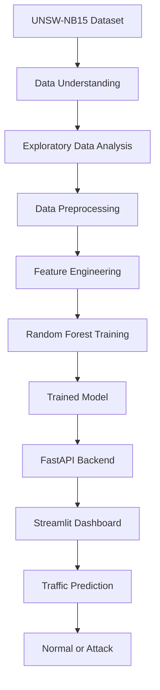

# AI-Based Network Intrusion Detection System

An end-to-end machine learning-based Network Intrusion Detection System (NIDS) that analyzes network traffic and classifies activities as **Normal** or **Attack** using a Random Forest classifier.

The project uses the UNSW-NB15 dataset, Scikit-learn for machine learning, FastAPI for the prediction API, and Streamlit for the interactive dashboard.

## Project Overview

Network security is an important concern because malicious network activities can compromise systems, services, and sensitive information.

This project aims to build a machine learning-based intrusion detection system that identifies potentially malicious network traffic based on network flow features.

The system provides:

- Network traffic classification as Normal or Attack.
- Attack probability estimation.
- A trained Random Forest classification pipeline.
- REST API endpoints using FastAPI.
- An interactive monitoring dashboard using Streamlit.
- Prediction history and traffic analysis visualizations.

## Technologies Used

| Category              | Technology               |
| --------------------- | ------------------------ |
| Programming Language  | Python                   |
| Data Processing       | Pandas, NumPy            |
| Data Visualization    | Matplotlib, Seaborn      |
| Machine Learning      | Scikit-learn             |
| ML Algorithm          | Random Forest Classifier |
| Model Serialization   | Joblib                   |
| Backend               | FastAPI                  |
| API Server            | Uvicorn                  |
| Frontend              | Streamlit                |
| Dependency Management | uv                       |
| Dataset               | UNSW-NB15                |

## Dataset

This project uses the **UNSW-NB15 dataset**, a network intrusion detection dataset containing normal network traffic and different categories of attack traffic.

The dataset includes network flow features such as:

- Protocol information
- Network service
- Connection state
- Source and destination bytes
- Packet counts
- Network traffic rates
- Connection statistics

### Dataset Download

Download the UNSW-NB15 dataset from the official UNSW Canberra Cyber dataset resource:

https://research.unsw.edu.au/projects/unsw-nb15-dataset

Download the following files and place them inside the `Dataset/` directory:

```text
Dataset/
├── UNSW_NB15_training-set.csv
└── UNSW_NB15_testing-set.csv
```

The preprocessing script uses these two files.

**Note:** Dataset files are not included in this GitHub repository because of their size.

### Target Variable

The target variable is `label`:

| Label | Classification |
| ----- | -------------- |
| 0     | Normal         |
| 1     | Attack         |

The `attack_cat` and `id` columns are excluded from model training.

## Project Architecture



## Project Structure

```text
AI_Based_Network_Intrusion_Detection_System/
│
├── app/
│   └── main.py
│
├── Dataset/
│   └── Download dataset files here
│
├── dataset_processed/
│   └── Generated during preprocessing
│
├── frontend/
│   └── streamlit_app.py
│
├── models/
│   └── classification_threshold.json
│
├── notebooks/
│
├── reports/
│   ├── classification_report.txt
│   ├── model_metrics.csv
│   ├── threshold_evaluation.csv
│   ├── threshold_test_comparison.csv
│   └── figures/
│
├── src/
│   ├── 01_dataset_understanding.py
│   ├── 02_exploratory_data_analysis.py
│   ├── 03_data_preprocessing.py
│   ├── 04_train_model.py
│   ├── 05_feature_importance.py
│   ├── 06_threshold_tuning.py
│   ├── 07_evaluate_tuned_model.py
│   └── 08_generate_api_sample.py
│
├── .gitignore
├── .python-version
├── pyproject.toml
├── uv.lock
└── README.md
```

**Important:** The trained model (`random_forest_nids.joblib`) and processed datasets are generated locally and are not committed to this repository.

## Machine Learning Workflow

The project follows these steps:

1. **Dataset Understanding:** Understand dataset structure, features, and target variables.
2. **Exploratory Data Analysis:** Analyze distributions, correlations, and attack categories.
3. **Data Preprocessing:** Separate features and target, identify numerical and categorical columns, and prepare training and testing data.
4. **Feature Encoding:** Apply OneHotEncoder to categorical features.
5. **Model Training:** Train a Random Forest classifier.
6. **Feature Importance:** Identify the most influential features.
7. **Threshold Evaluation:** Compare classification performance at different probability thresholds.
8. **Model Evaluation:** Evaluate the final model using the official testing dataset.

## Model Details

The project uses a **Random Forest Classifier**.

### Model Configuration

| Parameter                | Value         |
| ------------------------ | ------------- |
| Algorithm                | Random Forest |
| Number of Estimators     | 200           |
| Random State             | 42            |
| Class Weight             | balanced      |
| Numerical Imputation     | Median        |
| Categorical Imputation   | Most Frequent |
| Categorical Encoding     | OneHotEncoder |
| Unknown Categories       | ignore        |
| Classification Threshold | 0.50          |

### Preprocessing Pipeline

The preprocessing pipeline uses:

- **Numerical features:** Median imputation.
- **Categorical features:** Most frequent value imputation followed by OneHotEncoder.
- **Unknown categories:** Ignored during transformation to support unseen categorical values.

The preprocessing and classification steps are combined into a Scikit-learn pipeline.

### Input Features

The model uses 42 input features:

- 39 numerical features.
- 3 categorical features: `proto`, `service`, and `state`.

The `id` and `attack_cat` columns are not used as model inputs.

## Model Evaluation

The final model was evaluated using the official UNSW-NB15 testing dataset with a classification threshold of 0.50.

### Performance Metrics

| Metric    |  Score |
| --------- | -----: |
| Accuracy  | 90.30% |
| Precision | 98.80% |
| Recall    | 86.81% |
| F1 Score  | 92.42% |
| ROC-AUC   | 0.9827 |

### Confusion Matrix

The confusion matrix at threshold 0.50:

|               | Predicted Normal | Predicted Attack |
| ------------- | ---------------: | ---------------: |
| Actual Normal |           55,441 |              559 |
| Actual Attack |           15,461 |          103,880 |

**Note:** These results are from the official test dataset. Performance on other network traffic may differ.

## Installation and Setup

### Prerequisites

- Python 3.14 or later.
- Git.
- uv package manager.

### 1. Clone the Repository

Replace `JeyaShankar257` with your GitHub username.

```bash
git clone https://github.com/JeyaShankar257/AI_Based_Network_Intrusion_Detection_System.git
```

```bash
cd AI_Based_Network_Intrusion_Detection_System
```

### 2. Install Dependencies

Install the project dependencies using uv:

```bash
uv sync
```

### 3. Download the Dataset

Download the UNSW-NB15 training and testing CSV files and place them inside the `Dataset/` directory.

Required files:

```text
Dataset/
├── UNSW_NB15_training-set.csv
└── UNSW_NB15_testing-set.csv
```

### 4. Run Data Preprocessing

```bash
uv run python src/03_data_preprocessing.py
```

This generates the processed training and testing files inside `dataset_processed/`.

### 5. Train the Machine Learning Model

```bash
uv run python src/04_train_model.py
```

This trains the Random Forest classifier and generates:

```text
models/
└── random_forest_nids.joblib
```

**Important:** The model must be generated before starting the FastAPI backend.

## Running the Application

The application consists of two components:

- FastAPI backend for network traffic prediction.
- Streamlit frontend for interactive visualization.

### 1. Start FastAPI Backend

Open a terminal in the project root and execute:

```bash
uv run uvicorn app.main:app --reload
```

The API will run at:

```text
http://127.0.0.1:8000
```

### 2. Access API Documentation

Open the following URL in your browser:

```text
http://127.0.0.1:8000/docs
```

This provides interactive API documentation through Swagger UI.

### 3. Start Streamlit Frontend

Open another terminal in the project root and execute:

```bash
uv run streamlit run frontend/streamlit_app.py
```

The dashboard will be available at:

```text
http://localhost:8501
```

## API Endpoints

| Method | Endpoint   | Description                            |
| ------ | ---------- | -------------------------------------- |
| GET    | `/`        | API welcome message                    |
| GET    | `/health`  | Check API and model status             |
| POST   | `/predict` | Predict network traffic classification |

### Sample Prediction Response

```json
{
  "prediction": 1,
  "classification": "Attack",
  "attack_probability": 0.79,
  "threshold": 0.5,
  "message": "Suspicious network traffic detected."
}
```

The prediction endpoint expects all 42 model input features.

Refer to the Swagger documentation at `/docs` for the request schema and interactive testing.

## Streamlit Dashboard

The Streamlit application provides four main sections:

### 1. Dashboard Overview

- API and model status.
- Prediction summary.
- Traffic classification statistics.
- Prediction visualizations.

### 2. Traffic Analysis

- Analyze network traffic records.
- Submit traffic features for prediction.
- View classification and attack probability.

### 3. Prediction History

- View previous predictions.
- Analyze prediction history.
- Export prediction records as CSV.

### 4. Model Information

- View model configuration.
- Review model evaluation metrics.
- Understand the classification approach.

## Screenshots

Add screenshots of the Streamlit dashboard to a `screenshots/` directory and reference them here.

For example:

```markdown


```

## Limitations

- The system is trained and evaluated using the UNSW-NB15 dataset.
- Detection performance depends on the quality and representativeness of the training data.
- The current model performs binary classification: Normal or Attack.
- The system is a machine learning prototype and is not a replacement for a production-grade network security solution.
- Predictions depend on receiving valid input features in the expected format.

## Future Enhancements

- Integrate real-time network traffic capture.
- Add multi-class attack classification.
- Explore additional machine learning algorithms.
- Improve model performance on unseen network traffic.
- Add authentication and access control to the API.
- Integrate database storage for prediction history.
- Deploy the application to a cloud platform.

## Disclaimer

This project is developed for educational, learning, and research purposes. It demonstrates machine learning techniques for network intrusion detection and should not be considered a complete production-grade security system.

## Author

Developed as a machine learning and application development project.
